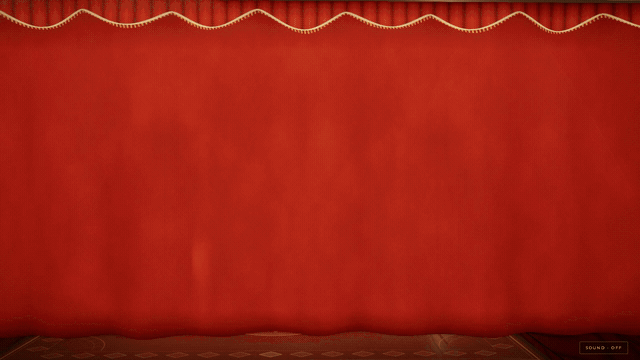
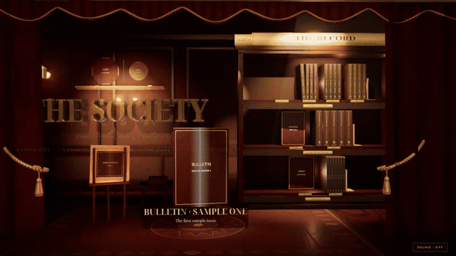
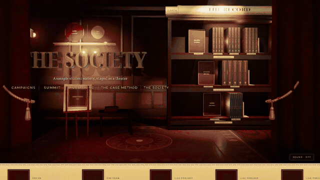

# Society Theater 3D (experimental)

A small experimental test project: a 3D theater-style website built for a student society at SGGSCC, Delhi University. The homepage is a WebGL stage with velvet curtains, a bookshelf of editions that can be picked up and read page by page, and a scrolling page below it with a post marquee, a split-flap results board, a poster section, a newsprint section and a credit roll. The society's content, photos and names were replaced with placeholders, so every name, number, image and article in this copy is sample data.

**Live demo:** https://vedant-aggarwal.github.io/society-theater-3d/



## What it looks like

Pulling copies off the shelf and turning pages in the reader (keyboard: Tab picks a copy, Enter opens it, arrow keys turn pages):



Scrolling away from the stage draws the curtain shut, then the page runs through the post marquee, the results board, the newsprint section and the credit roll:



Full 48-second walkthrough: [docs/demo/walkthrough.mp4](docs/demo/walkthrough.mp4). The clips were recorded in headless Chromium at 1600x900 and scaled down, so the GIFs show fewer colours than the live page.

## Run it

Serve the folder with any static server and open `theater3d.html` (or `index.html`, which redirects there):

```
python -m http.server 8000
```

Then visit http://localhost:8000/theater3d.html. Opening the file straight from disk will not work, because the ES modules, the import map and the JSON fetches need HTTP.

## Tech

- Plain HTML, CSS and JavaScript ES modules, with no build step.
- [three.js](https://threejs.org/) 0.169.0, loaded from the unpkg CDN through an import map (core, plus the RoomEnvironment, FontLoader, TextGeometry and post-processing addons).
- Web Audio API for the optional synthesized room sound.
- Google Fonts: Noto Serif Display, Crimson Pro and Montserrat. The extruded 3D wordmark uses a three.js typeface conversion of Noto Serif Display Condensed Bold, shipped in `assets/fonts/`.

## License

Code: MIT, see `LICENSE`. The font file in `assets/fonts/` is under the SIL Open Font License 1.1, see `assets/fonts/OFL.txt`.
